<!-- _paginate: false -->
<!-- _footer: Владивосток\n2025 -->

# Исследование алгоритмов БПФ и их параллельных форм

 

Выполнил: студент группы М9123-09.04.04рпис, А.В. Марков

Научный руководитель: Доцент департамента ПИиИИ, к.т.н., А.А. Чусов

<!--
Здравствуйте, уважаемые члены комиссии. Меня зовут Марков Андрей. Мой научный руководитель – Чусов Андрей Александрович. Тема моей выпускной квалификационной работы — исследование алгоритмов быстрого преобразования Фурье и их параллельных форм.
-->

---

# Актуальность работы

 

- БПФ — **основной инструмент** в цифровой обработке сигналов: изображения, аудио, видео, радиосвязь
- Объем обрабатываемых данных стремительно растет — требуется всё более быстрые алгоритмы для анализа
- Классические алгоритмы БПФ плохо масштабируются — важно адаптировать их **под многопроцессорные архитектуры**

 

<!--
В современном мире объём данных в прикладных задачах постоянно увеличивается — от обработки изображений до анализа сигналов. При этом задержки и энергопотребление становятся критичными, особенно в реальном времени или при работе на мобильных и встроенных устройствах. Быстрое преобразование Фурье — фундаментальный алгоритм, лежащий в основе этих систем, и его оптимизация под современные параллельные вычислительные архитектуры — ключевая задача. Современные теоретические исследования указывают на принципиальную возможность снижения вычислительной сложности до O(n), что представляет собой важнейшую перспективу развития алгоритмов спектрального анализа. Поэтому тема работы напрямую связана с актуальными направлениями в науке и промышленности.
-->

---

# Цель и задачи

**Цель:**  

Разработка и исследование параллельных реализаций алгоритмов БПФ.

**Задачи:**
1. Подготовить обзор алгоритмов БПФ и существующих библиотек
2. Выполнить анализ предметной области
3. Реализовать алгоритмы и выполнить эксперименты
4. Исследовать производительность в различных условиях
5. Сформулировать практические выводы по результатам исследования

<!--
На данном слайде представлены цели и задачи, которые направлены не только на теоретический анализ, но и на практическую реализацию с выводами о применимости алгоритмов в реальных задачах. Полученные результаты могут быть использованы как в инженерных решениях, так и в дальнейших научных исследованиях.
-->

---

<!-- _footer: Задача 1. Обзор алгоритмов БПФ и существующих библиотек -->

# Дискретное преобразования Фурье (ДПФ)

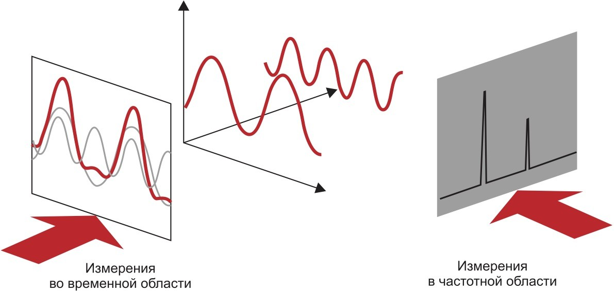

 

Прямое ДПФ: $X_k = \sum_{n=0}^{N-1} x_n \cdot e^{-2\pi i \frac{kn}{N}}, \quad k = 0, 1, \dots, N-1$

Обратное ДПФ: $x_n = \frac{1}{N} \sum_{k=0}^{N-1} X_k \cdot e^{2\pi i \frac{kn}{N}}, \quad n = 0, 1, \dots, N-1$

<!--
Для начала немного рассмотрим дискретное преобразование Фурье, чтобы понимать некоторые аспекты. ДПФ нужен для перевода сигнала из временной области в частотную. Прямое ДПФ вычисляет спектр сигнала — набор комплексных коэффициентов, которые показывают амплитуду и фазу каждой гармоники, в то время как обратное ДПФ выполняет, как можно догадаться, обратную операцию. На этом слайде показаны два ключевых выражения — для прямого и обратного ДПФ, однако из-за квадратичной сложности алгоритм плохо масштабируется на большие данные.
-->

---

<!-- _footer: Задача 1. Обзор алгоритмов БПФ и существующих библиотек -->

# Быстрое преобразование Фурье (БПФ)

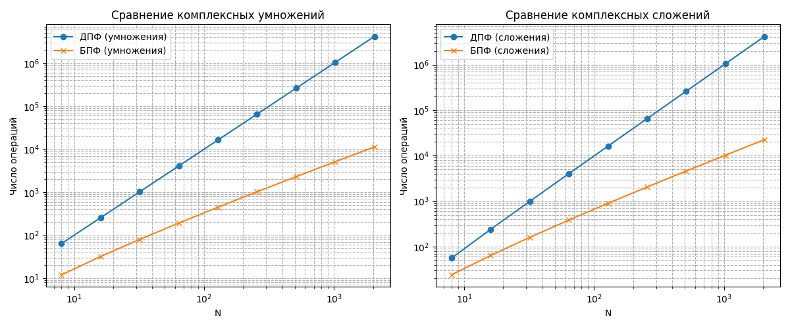

<!--
Быстрое преобразование Фурье устраняет проблему квадратичной сложности ДПФ, сохраняя идентичность результата, но достигая существенного ускорения вычислений. Это возможно благодаря эффективному учёту симметрии и периодичности комплексных экспонент, что минимизирует число требуемых операций. На слайде показаны графики сравнения количества комлексных операций в ДПФ и БПФ, в качестве которого взят классический алгоритм Кули-Тьюки.
-->

---

<!-- _footer: Задача 1. Обзор алгоритмов БПФ и существующих библиотек -->

# Обзор существующих алгоритмов

 

| Алгоритм    | Ключевые особенности                                                                                            |
| ----------- | --------------------------------------------------------------------------------------------------------------- |
| Кули-Тьюки  | Базовый алгоритм; эффективен при длине $N = k^n$                                                                |
| Стокхама    | Итеративная структура; эффективен по памяти                                                                     |
| Блюстейна   | Работает с произвольной длиной $N$                                                                              |
| Гуда-Томаса | Основан на КТО; не требует поворотных множителей; эффективен при взаимно простых множителях $N = N_1 \cdot N_2$ |

 

<!--
На слайде представлен обзор затронутых алгоритмов БПФ. Каждый алгоритм решает свои задачи: Кули-Тьюки — базовый и наиболее часто применяемый, особенно когда N является степенью двойки; алгоритм Блюстейна применим для чисел, неудобных для классического разложения, включая простые N; алгоритм Стокхама обладает итеративной природной, за счет чего эффективно работает с памятью; алгоритм Гуда-Томаса эффективен при работе с длинами, разлагающимися на взаимно простые множители. Такой спектр методов позволяет подбирать оптимальный алгоритм под конкретные условия задачи.
-->

---

<!-- _footer: Задача 1. Обзор алгоритмов БПФ и существующих библиотек -->

# Сравнение библиотек БПФ

 

| Характеристика \ Библиотека   | FFTW | cuFFT | TurboFFT | NumPy/SciPy | PyCUDA/Numba |
| ----------------------------- | ---- | ----- | -------- | ----------- | ------------ |
| Поддержка CPU                 | +    | –     | –        | +           | –            |
| Поддержка GPU                 | –    | +     | +        | –           | +            |
| Высокая производительность    | +    | +     | +        | –           | +            |
| Оптимизация под архитектуру   | +    | –     | +        | –           | –            |
| Параллелизм (многопоточность) | +    | –     | +        | + (BLAS)    | –            |
| Аппаратная оптимизация        | +    | +     | +        | –           | +            |

<!--
Данная таблица отражает ключевые различия библиотек по архитектуре и производительности. FFTW хорош для CPU и многопоточности, cuFFT и TurboFFT — для GPU и высокой скорости, особенно при поддержке аппаратной оптимизации. NumPy удобен, но уступает в скорости, а PyCUDA требует ручной настройки. В целом выбор зависит от оборудования и задач.
-->

---

<!-- _footer: Задача 2. Анализ предметной области -->

# Оценка оперативности алгоритма, адаптированного для мультипроцессинга

Пусть $T$ — общее количество доступных процессоров;
&nbsp;&nbsp;&nbsp;&nbsp;&nbsp;&nbsp;&nbsp;&nbsp;&nbsp;&nbsp; $N$ — размер последовательности для преобразования;
&nbsp;&nbsp;&nbsp;&nbsp;&nbsp;&nbsp;&nbsp;&nbsp;&nbsp;&nbsp; $С$ — оценка асимптотической сложности алгоритма.

Тогда эффективность оперативности алгоритма расчитывает как:

$$\eta_t = \frac{O\left(\frac{C}{T}\right) + t_{comm}(N, T)}{t_{real}},$$

где $t_{comm}(N, T)$ — время на коммуникацию между процессорами;
&nbsp;&nbsp;&nbsp;&nbsp;&nbsp;&nbsp; $t_{real}$ — реальное время выполнения.

<!--
На данном слайде представлена формальная оценка эффективности параллельного алгоритма. Ключевыми параметрами оценки 
временной эффективности являются число процессоров (T), размер задачи (N) и сложность алгоритма (C). Основная формула показывает, как теоретическое ускорение корректируется с учётом коммуникационных издержек и реального времени выполнения. Это нужно, чтобы понимать, когда распараллеливание действительно даёт выигрыш.
-->

---

<!-- _footer: Задача 2. Анализ предметной области -->

# Оценка энергопотребления алгоритма, адаптированного для мультипроцессинга

Пусть $t_1$ — время выполнения однопоточной версии;
&nbsp;&nbsp;&nbsp;&nbsp;&nbsp;&nbsp;&nbsp;&nbsp;&nbsp;&nbsp; $P_1$ — средняя мощность однопоточной версии;
&nbsp;&nbsp;&nbsp;&nbsp;&nbsp;&nbsp;&nbsp;&nbsp;&nbsp;&nbsp; $t_p$ — время выполнения параллельной версии (на $T$ потоках);
&nbsp;&nbsp;&nbsp;&nbsp;&nbsp;&nbsp;&nbsp;&nbsp;&nbsp;&nbsp; $P_p$ — средняя мощность параллельной версии.

Тогда энергоэффективность алгоритма расчитывает как:  
$$\eta_E = \frac{E_{seq}}{E_{par}} = \frac{P_1 \cdot t_1}{P_p \cdot t_p}$$

<!--
Данный слайд дополняет временную модель оценкой энергозатрат. Эта формула связывает время выполнения, число процессоров и их энергопотребление.
-->

---

<!-- _footer: Задача 2. Анализ предметной области -->

# Разработанные схемы (1/2)

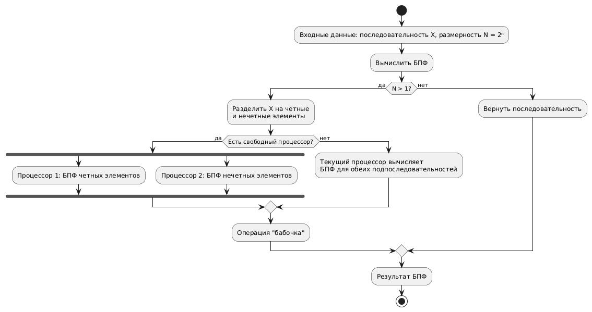

<!--
Для всех рассмотренных в обзоре алгоритмов были разработаны модели параллельных реализаций и соответствующие блок-схемы. В качестве иллюстративного примера на данном слайде приведена блок-схема параллельной версии классического алгоритма Кули-Тьюки.
-->

---

<!-- _footer: Задача 2. Анализ предметной области -->

# Разработанные схемы (2/2)

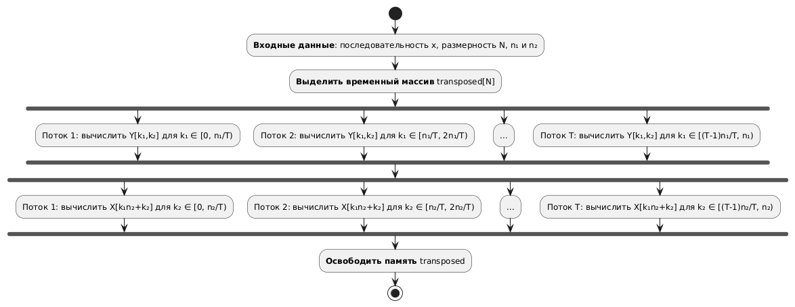

<!--
В качестве второго примера представлена блок-схема параллельной версии алгоритма Гуда-Томаса. Со всеми остальными можно ознакомиться в полном тексте ВКР.
-->

---

<!-- _footer: Задача 3. Реализация алгоритмов и выполнение экспериментов -->

# Подход к проектированию

&nbsp;&nbsp;&nbsp;&nbsp;&nbsp;&nbsp;&nbsp;&nbsp;&nbsp;&nbsp;&nbsp;&nbsp;&nbsp;&nbsp;&nbsp;&nbsp;&nbsp;&nbsp;&nbsp;&nbsp;
  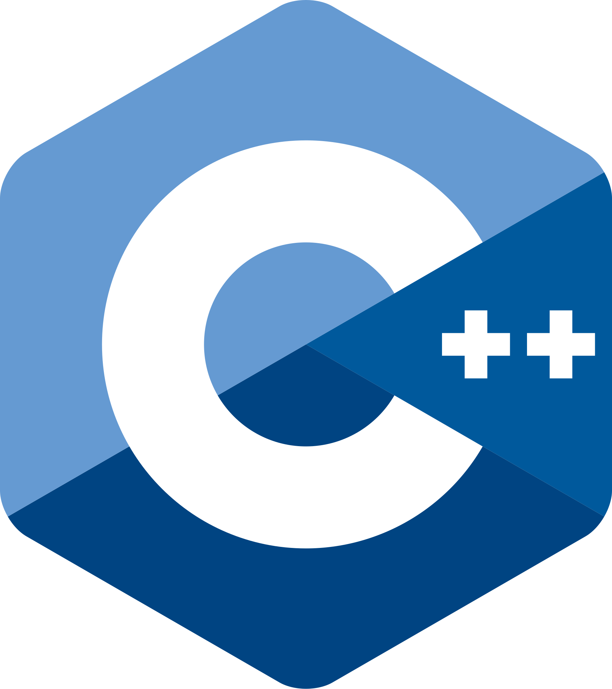
&nbsp;&nbsp;&nbsp;&nbsp;&nbsp;&nbsp;&nbsp;&nbsp;&nbsp;&nbsp;&nbsp;&nbsp;&nbsp;&nbsp;&nbsp;&nbsp;&nbsp;&nbsp;&nbsp;&nbsp;
  

<!--
Для реализации системы замеров был выбран язык программирования C++, что обусловлено его поддержкой объектно-ориентированного подхода, высокой производительностью, а также возможностями низкоуровневой работы с памятью и многопоточности. Для анализа данных и построения графиков взята технология Jupyter Notebook, поскольку она обеспечивает гибкость и удобство работы в сфере анализа данных.
-->

---

<!-- _footer: Задача 3. Реализация алгоритмов и выполнение экспериментов -->

# Система проведения замеров (1/2)

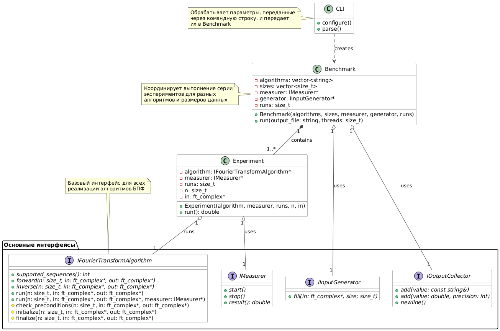

<!--
В ходе выполнения данной работы была разработана модульная система проведения измерений, построенная на принципах объектно-ориентированного проектирования. Система предусматривает возможность подключения новых реализаций алгоритмов, соответствующих интерфейсу FourierTransformAlgorithm, а также расширяемость подобным образом в части измерителей и генераторов входных последовательностей.
-->

---

<!-- _footer: Задача 3. Реализация алгоритмов и выполнение экспериментов -->

# Система проведения замеров (2/2)

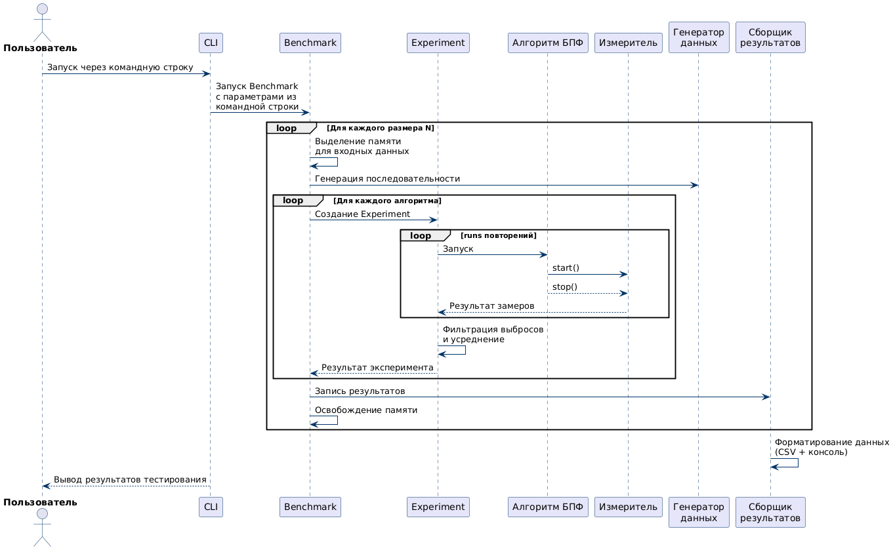

<!--
На данном слайде изображена диаграмма последовательности работы системы проведения замеров. На ней показано, как взаимодействует пользователь с системой: с помощью командной строки он запускает программу, передавая необходимые параметры. Эти параметры принимает объект Benchmark, который инициирует выполнение цикла экспериментов на основе переданных ему параметров. По завершении каждого эксперимента результаты сохраняются в CSV-файл и отображаются в консоли.
-->

---

<!-- _footer: Задача 4. Исследование производительности в различных условиях -->

# Исследование влияния форм алгоритмов на эффективность параллелизма (1/2)

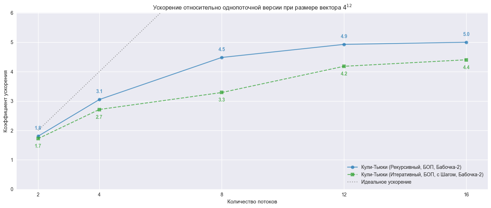

<!--
Плавно перейдем к экспериментам. В рамках данных исследований изучалось влияние структуры алгоритма на степень его параллелизма. В качестве первого объекта исследования был выбран алгоритм Кули-Тьюки, который может быть реализован как рекурсивно, так и итеративно. Как показали результаты, рекурсивная версия демонстрирует лучшие показатели в плане распараллеливания, несмотря на определенные неудобства в управлении памятью. Это связано с тем, что рекурсивная организация алгоритма позволяет более естественным образом распределять задачи между процессорами, минимизируя время, затрачиваемое на межпроцессорные взаимодействия.
-->

---

<!-- _footer: Задача 4. Исследование производительности в различных условиях -->

# Исследование влияния форм алгоритмов на эффективность параллелизма (2/2)

  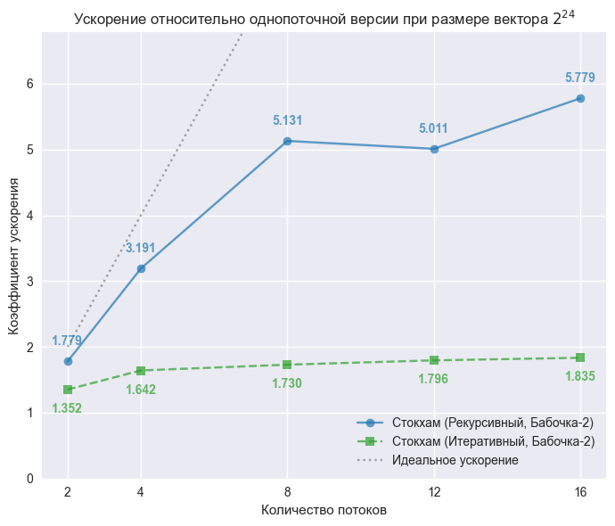
  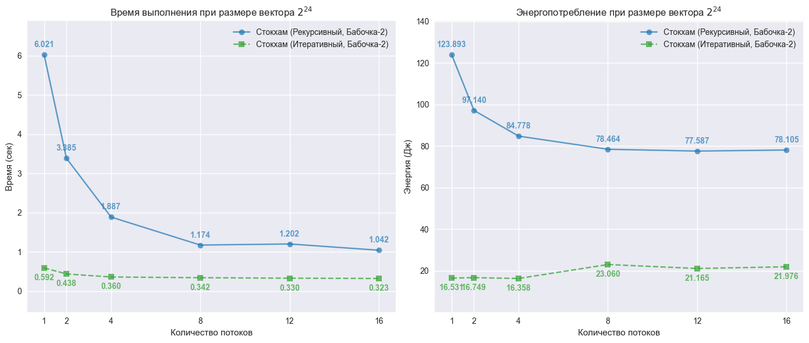

<!--
Теперь сравним две формы метода Стокхама — рекурсивную и итеративную. Как и в предыдущем случае, рекурсивный подход демонстрирует более высокую степень распараллеливания, в то время как выигрыш итеративной версии остается почти неизменным. При этом стоит отметить, что эффективность оперативности и энергопотрбления итеративной формы значительно выше.
-->

---

<!-- _footer: Задача 4. Исследование производительности в различных условиях -->

# Исследование влияния стратегий управления потоков на эффективность параллелизма

&nbsp;&nbsp;&nbsp;&nbsp;
  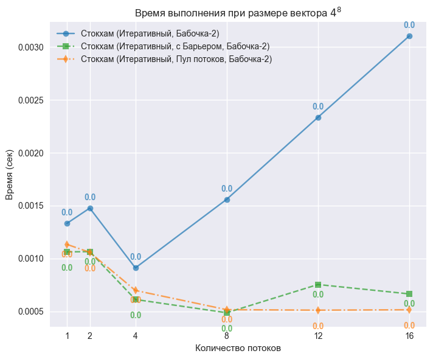
&nbsp;&nbsp;&nbsp;&nbsp;
  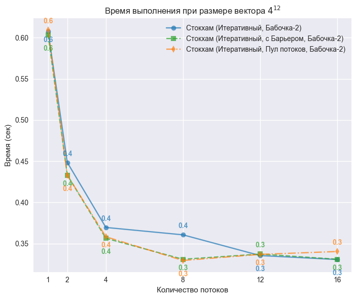

<!--
В следующем исследовании сравнивались стратегии управления потоками в итеративной реализации метода Стокхама. Как показывают результаты, использование Thread Pool с барьерной синхронизацией даёт наибольший выигрыш при обработке небольших последовательностей, - график слева. Однако на крупных объёмах, - график справа, разница между подходами практически исчезает — время вычислений становится доминирующим фактором, затмевая накладные расходы на управление параллелизмом. Это объясняется доминированием времени собственно вычислений над накладными расходами на управление потоками.
-->

---

<!-- _footer: Задача 5. Практические выводы по результатам исследования -->

# Выводы по результатам исследования

 

- **Рекурсивные** версии алгоритмов демонстрируют **лучшую** масштабируемость на многопоточных архитектурах.
- **Thread Pool** и **барьерная синхронизация** эффективны для данных **среднего** размера, но преимущество **нивелируется** на больших объёмах.

 
 
 

<!--
Проведённые исследования алгоритмов быстрого преобразования Фурье показали, что рекурсивные версии Кули-Тьюки и Стокхама лучше адаптируются к параллельным архитектурам и обеспечивают высокую масштабируемость, однако уступают итеративным реализациям в однопоточной производительности и энергоэффективности. Использование Thread Pool и барьерной синхронизацией оказалось эффективным для данных среднего объёма, но на крупных массивах преимущество снижается за счёт доминирования времени вычислений.

Остальные эксперементы и выводы по ним доступны в полном тексте ВКР.
-->

---

# Заключение

 

1. Подготовлен обзор алгоритмов БПФ и существующих библиотек
2. Выполнен анализ предметной области
3. Реализованы алгоритмы и выполнить эксперименты
4. Исследована производительность в различных условиях
5. Сформулированы практические выводы по результатам исследования

 

**Цель достигнута, задачи решены**

<!--
Все поставленные задачи решены. Результаты работы могут быть применены как в индустрии, так и в дальнейшем научном исследовании.
-->

---

# Демонстрация программной системы

<!--
Готов перейти к демонстрации программной системы
-->
